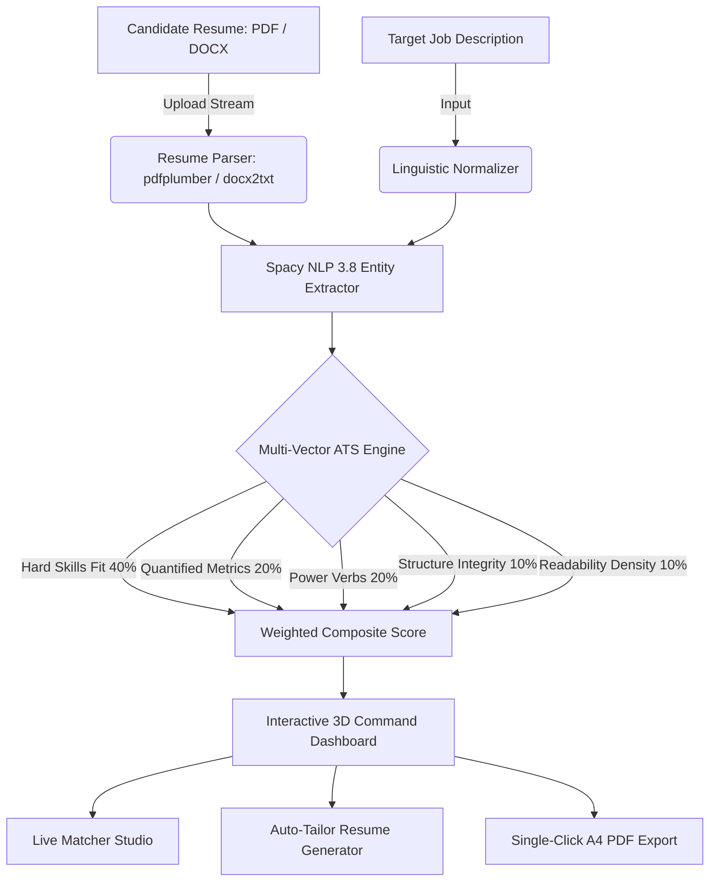

<div align="center">

# ⚡ B-ResumeX
### **Next-Generation 3D AI ATS Resume Matrix & Career Intelligence Engine**

[](https://fastapi.tiangolo.com)
[](https://python.org)
[](https://spacy.io)
[](https://tailwindcss.com)
[](https://www.docker.com/)
[](https://opensource.org/licenses/MIT)

<p align="center">
  <b>Simulate enterprise Applicant Tracking Systems (Workday, Greenhouse, Lever).</b><br>
  Extract deep semantic keywords, quantify impact metrics, and auto-tailor your resume in real time.
</p>

[Explore Features](#-key-features) • [Quick Start](#-quick-start) • [Architecture](#-system-architecture) • [Live Simulator](#-live-ats-matcher-studio)

---

</div>

<br>

## 🌟 Overview

**B-ResumeX** is a cutting-edge, enterprise-grade AI resume intelligence platform built to demolish corporate applicant tracking filters. Designed with a **futuristic 3D cyber-aesthetic**, it evaluates resumes across **5 distinct algorithmic vectors** using **Spacy NLP** and machine learning heuristics, providing candidates with instant feedback, live job-description re-scoring, and recruiter-ready A4 PDF export capabilities.

---

## 🚀 Key Features

### 🧠 1. Multi-Vector Semantic ATS Engine (`spacy`)
Unlike basic keyword counters, B-ResumeX deploys deep linguistic analysis:
* 🎯 **Semantic Hard Skills Matcher (40%)**: Linguistic noun & proper noun extraction cross-referenced against 40+ engineering taxonomies.
* 📈 **Quantified Impact Density (20%)**: Named entity & pattern detection for percentages, latencies, dollar volumes, and scale metrics (`42%`, `1.5M users`, `$180k`).
* ⚡ **Action Verb Power Index (20%)**: Analyzes executive active verbs (*Architected, Championed, Automated*) versus weak passive phrasing.
* 📐 **Section Completeness & Integrity (10%)**: Validates standard ATS structural sections (*Summary, Experience, Education, Skills, Projects*).
* 📖 **Readability & Density Index (10%)**: Eliminates parser choke points, word stuffing, or brevity penalties.

---

### 🎛️ 2. Live ATS Matcher Studio & Auto-Tailoring
* **Real-Time Job Description Matcher**: Tweak or paste any target Job Description on the fly — score gauges and 5-dimension vector bars recalculate live with zero page reloads.
* **✨ One-Click Auto-Tailoring**: Injects missing target competencies into structured bullets to immediately boost scores into the 85%+ green zone.
* **Live JSON Data Architect**: Interactive modal editor that immediately live-renders adjustments into the A4 preview.

---

### 🌐 3. Futuristic 3D Cyberpunk Interface
* **Interactive 3D Particle Constellation**: Responsive canvas mesh that reacts to cursor proximity and physics.
* **Vanilla-Tilt 3D Cards**: Realistic perspective depth with specular glare and elevation physics on hover.
* **3D Sweeping Laser Scanner**: Real-time scanner simulator with customizable roles (*Full-Stack Lead*, *AI/ML Engineer*, *Cloud/DevOps*).
* **Confetti Engine**: Interactive celebration effects upon achieving top-tier ATS compatibility.

---

### 🛠️ 4. Neural Career Tools
* 📝 **Cover Letter Architect**: Auto-generates tailored, JD-aligned cover letter drafts based on your latest parsed credentials.
* 🎤 **Role Interview Simulator**: Formulates role-specific behavioral and technical interview questions targeting candidate skillsets.
* 🔍 **Deep Skill Gap Matrix**: Detects missing technical tools and provides an actionable 3-step bridge plan.
* 🖨️ **Recruiter-Ready PDF Export**: Clean, single-column A4 format with dedicated `@media print` typography — 100% immune to ATS parsing issues.

---

## 🏗️ System Architecture



---

## ⚡ Quick Start

### 1. Clone the Repository
```bash
git clone https://github.com/bharat-kumaar/B-ResumeX.git
cd B-ResumeX
```

### 2. Set Up Virtual Environment
```bash
# Windows
python -m venv venv
.\venv\Scripts\Activate.ps1

# Linux / macOS
python3 -m venv venv
source venv/bin/activate
```

### 3. Install Dependencies & Spacy Model
```bash
pip install -r requirements.txt
python -m spacy download en_core_web_sm
```

### 4. Launch Application
```bash
python -m uvicorn app.main:app --reload --port 8000
```
Open your browser at: **`http://127.0.0.1:8000`**

---

## 🐳 Docker Deployment

Run the complete containerized environment in one command:

```bash
docker compose up --build -d
```
The application will be live at `http://localhost:8000`.

---

## 📁 Project Structure

```
B-ResumeX/
├── app/
│   ├── api/
│   │   ├── analyze.py       # Resume parsing, live re-scoring & auto-tailoring
│   │   ├── auth.py          # Secure JWT auth (Login, Signup, Logout)
│   │   ├── dashboard.py     # User telemetry & analytics API
│   │   └── tools.py         # Cover letter, interview prep & skill gap endpoints
│   ├── core/
│   │   ├── db.py            # SQLite / SQLModel database initialization
│   │   ├── deps.py          # Dependency injection & JWT session resolution
│   │   └── security.py      # Password hashing (bcrypt) & token creation
│   ├── models/
│   │   └── domain.py        # Database schema (User, Resume, AnalysisReport)
│   ├── services/
│   │   ├── ai_service.py    # Structured resume generation & rewrites
│   │   ├── ats_scorer.py    # Spacy 5-dimension multi-vector scoring algorithm
│   │   └── resume_parser.py # PDF/DOCX text & entity extractor
│   └── templates/
│       ├── base.html        # 3D canvas particles, Vanilla-Tilt, cyberpunk layout
│       ├── index.html       # Hero, live 3D laser scanner, interactive role simulator
│       ├── dashboard.html   # Command center, drag-and-drop dropzone, career suite
│       ├── report.html      # Live ATS studio, A4 resume canvas, JSON modal editor
│       ├── login.html       # 3D glassmorphic authentication interface
│       └── signup.html      # 3D glassmorphic workspace creator
├── docker-compose.yml       # Production container orchestration
├── Dockerfile               # Multi-stage container build
├── requirements.txt         # Core dependencies
└── README.md                # Project documentation
```

---

## 🛡️ License

Distributed under the **MIT License**. See `LICENSE` for more information.

---

<div align="center">
  <sub>Engineered with ❤️ by <a href="https://github.com/bharat-kumaar">Bharat Kumar</a>. Built for candidates targeting elite engineering roles.</sub>
</div>
